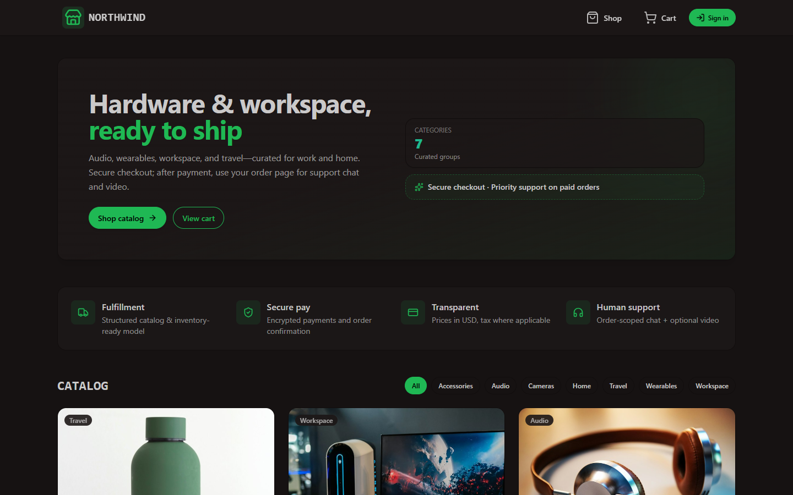
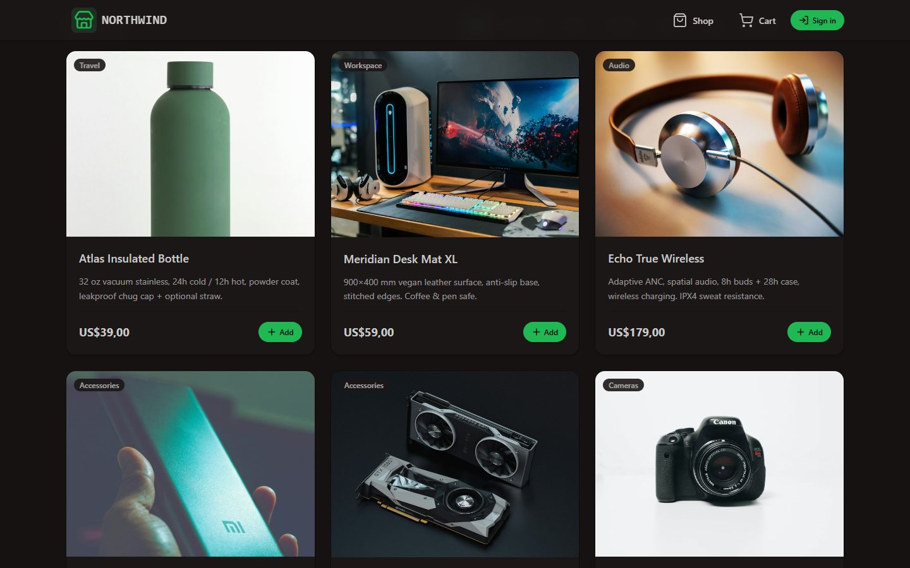
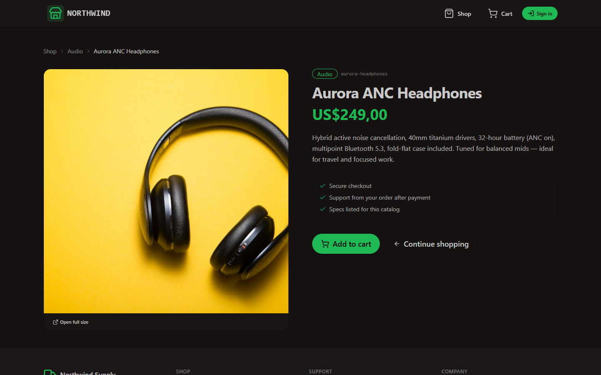
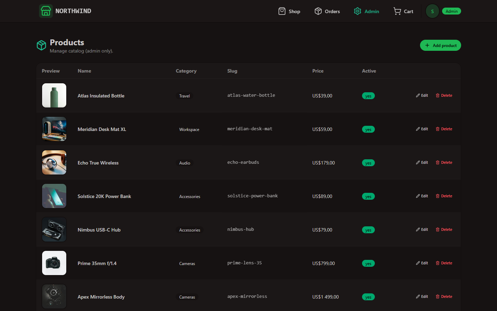
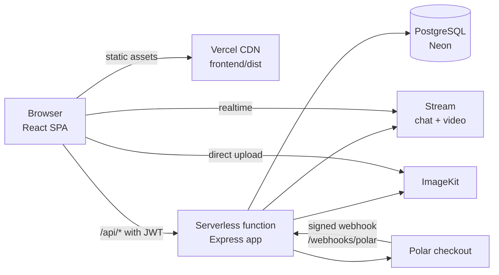

# Northwind Store

A full-stack e-commerce platform built on the PERN stack (PostgreSQL, Express, React, Node.js). Customers browse a catalog, check out securely and get order-scoped support chat with optional video calls. Admins manage the catalog from a dashboard. The whole app ships as a single Vercel deployment.

<!-- Live demo: add your Vercel URL here after deploying, e.g. **[Live demo](https://your-app.vercel.app)** -->




| Catalog | Product page | Admin dashboard |
| --- | --- | --- |
|  |  |  |

---

## Features

**For customers**
- Product catalog with category filtering and shareable, slug-based product pages
- Persistent shopping cart (kept across page reloads, cleared on sign-out)
- Email/password accounts with secure sessions
- Hosted checkout through Polar, with orders created from a verified payment webhook
- Order history, and a private support chat for every paid order (typing indicators, reactions, threads, file and GIF sharing)
- One-click video calls with support staff, started from inside the chat

**For staff and admins**
- Role-based access: `customer`, `support` and `admin`
- Admin dashboard to create, edit, deactivate and delete products
- Direct-to-CDN image uploads with on-the-fly resizing and format conversion (ImageKit)
- Support staff see all orders and can invite customers to a video call

**Platform**
- Error tracking, performance tracing and session replay with Sentry (frontend and backend)
- One command starts the whole stack locally, including the database
- Deploys to Vercel as one project: static frontend plus a serverless API, with database migrations applied on every deploy

---

## Tech stack

| Layer | Technologies |
| --- | --- |
| Frontend | React 19, Vite, React Router 7, TanStack Query, Zustand, Tailwind CSS 4, daisyUI |
| Backend | Node.js 22, Express 5, TypeScript, Zod |
| Database | PostgreSQL, Drizzle ORM, versioned SQL migrations |
| Auth | JSON Web Tokens, bcrypt password hashing, role-based authorization |
| Integrations | Polar (payments), Stream (chat and video), ImageKit (image CDN), Sentry (monitoring) |
| Infrastructure | Vercel (static hosting + serverless functions), Neon (serverless Postgres), Docker |

---

## Architecture



- **One codebase, one deployment.** The React app is built to static files and served from Vercel's CDN. The Express app in `backend/src/app.ts` is wrapped by [`api/index.ts`](api/index.ts) as a single serverless function. `vercel.json` routes `/api/*` and `/webhooks/*` to it and everything else to the SPA, so the frontend and API share an origin and need no CORS or API URL configuration.
- **The same Express app runs everywhere.** `backend/src/index.ts` adds `listen()` for local development and Docker, while Vercel imports the app directly.
- **Layered backend.** Routes delegate to controllers; shared concerns (auth, environment validation, role checks, third-party clients) live in `backend/src/lib`.

---

## Engineering highlights

- **Custom authentication.** Email/password auth with bcrypt-hashed passwords and signed JWTs carried as Bearer tokens. A middleware attaches the user to each request, and admin and support routes check roles server-side. User queries use an explicit column projection, so the password hash never leaves the database layer.
- **Reliable payment fulfillment.** Polar webhooks are verified with Standard Webhooks signatures before they are trusted. Fulfillment runs in a database transaction with a row lock on the checkout session and an idempotency check, so a webhook delivered twice cannot create a duplicate order.
- **Validated configuration.** Environment variables are parsed with Zod at startup, so a misconfiguration fails fast with a clear message. Optional integrations degrade gracefully: if payments, chat or uploads are not configured, their endpoints return `503` and the rest of the store keeps working.
- **Safe database changes.** Production uses versioned SQL migrations generated by Drizzle Kit and applied on each deploy. Seeding is idempotent: the catalog is only seeded into an empty database and the admin account is only created if it is missing. The deploy stops early with an actionable error if required settings are absent.
- **Zero-install local database.** `npm run dev` starts a real PostgreSQL 17 server through `embedded-postgres`, creates the database, syncs the schema and seeds it, then runs the API and frontend alongside it. No Docker or system-wide Postgres install is needed.
- **Optimized images.** Product images are stored once and requested at the exact size and format each view needs through ImageKit URL transformations.

---

## Project structure

```
.
├── api/index.ts            # Vercel serverless entry (wraps the Express app)
├── backend/
│   ├── drizzle/            # Versioned SQL migrations
│   ├── scripts/            # Local DB runner, migrations, seeding, role management
│   └── src/
│       ├── app.ts          # Express app (routes, middleware, error handling)
│       ├── index.ts        # Local/Docker server entry
│       ├── controllers/    # Request handlers
│       ├── routes/         # Route definitions
│       ├── db/             # Drizzle schema and client
│       ├── lib/            # Auth, env validation, roles, Stream/ImageKit/Polar clients
│       └── webhooks/       # Polar payment webhook
├── frontend/
│   └── src/
│       ├── pages/          # Route-level views
│       ├── components/     # UI components and the auth provider
│       ├── hooks/          # Data-fetching hooks per page (TanStack Query)
│       ├── store/          # Cart state (Zustand)
│       └── lib/            # API client, auth hook, ImageKit helpers
├── vercel.json             # Single-project build and routing config
└── Dockerfile              # Alternative: one container serving API + SPA
```

---

## Getting started

**Prerequisites:** Node.js 22+. Nothing else is needed; the database runs from npm.

```bash
git clone https://github.com/sizwendlovu01/NorthWind-Store.git
cd NorthWind-Store
npm run setup                           # install root, backend and frontend dependencies
cp backend/.env.example backend/.env    # then set JWT_SECRET and SEED_ADMIN_PASSWORD
npm run dev                             # Postgres :5433, API :3001, web app :5173
```

Open http://localhost:5173 and sign in with the admin email and password from `backend/.env`, or create an account at `/sign-up`.

Useful scripts:

| Command | What it does |
| --- | --- |
| `npm run dev` | Start the database, API and frontend together |
| `npm --prefix backend run user:role -- <email> <role>` | Change a user's role (`customer`, `support`, `admin`) |
| `npm --prefix backend run db:generate` | Create a migration after editing the schema |
| `npm --prefix backend run db:studio` | Browse the database with Drizzle Studio |
| `npm --prefix frontend run lint` | Lint the frontend |

Local database files live in `~/.northwind/pgdata`, outside the project folder so cloud-sync tools cannot lock them.

---

## Deploying to Vercel

The repository deploys as **one** Vercel project; all build settings come from [`vercel.json`](vercel.json).

1. Create a free Postgres database on [Neon](https://neon.tech) and copy its pooled connection string.
2. In Vercel, import this repository. Leave the root directory and build settings at their defaults.
3. Add environment variables: `DATABASE_URL`, `JWT_SECRET` (32+ random characters), `SEED_ADMIN_EMAIL` and `SEED_ADMIN_PASSWORD`. Integration keys are optional.
4. Deploy. The build applies migrations, seeds the catalog on first deploy and publishes the frontend and API together. Every push to `main` redeploys.

For payments, point the Polar webhook at `https://<your-domain>/webhooks/polar`.

---

## Environment variables

Backend (`backend/.env` locally, Vercel project settings in production):

| Variable | Required | Purpose |
| --- | --- | --- |
| `DATABASE_URL` | Yes | PostgreSQL connection string |
| `JWT_SECRET` | Yes | Secret for signing session tokens (32+ characters) |
| `JWT_EXPIRES_IN` | No | Session length, default `7d` |
| `SEED_ADMIN_EMAIL`, `SEED_ADMIN_PASSWORD` | No | Admin account created by the seed step |
| `FRONTEND_URL` | No | Public URL for payment redirects; defaults to the Vercel production domain |
| `POLAR_ACCESS_TOKEN`, `POLAR_WEBHOOK_SECRET`, `POLAR_CHECKOUT_PRODUCT_ID`, `POLAR_API_BASE` | No | Payments |
| `STREAM_API_KEY`, `STREAM_API_SECRET` | No | Support chat and video calls |
| `IMAGEKIT_PUBLIC_KEY`, `IMAGEKIT_PRIVATE_KEY`, `IMAGEKIT_URL_ENDPOINT` | No | Admin image uploads |
| `SENTRY_DSN` | No | Backend error monitoring |

Frontend (all optional): `VITE_SENTRY_DSN`, `VITE_IMAGEKIT_URL_ENDPOINT`, and `VITE_API_URL` only if the API is hosted on a different origin.

---

## API reference

| Method | Endpoint | Access | Description |
| --- | --- | --- | --- |
| `POST` | `/api/auth/register` | Public | Create an account, returns a JWT |
| `POST` | `/api/auth/login` | Public | Sign in, returns a JWT |
| `GET` | `/api/me` | User | Current user and role |
| `GET` | `/api/products?category=` | Public | Active products, optionally filtered |
| `GET` | `/api/products/categories` | Public | Category list |
| `GET` | `/api/products/:slug` | Public | Single product |
| `POST` | `/api/checkout` | User | Create a Polar checkout for the cart |
| `GET` | `/api/orders` | User | Own orders (staff: all orders) |
| `GET` | `/api/orders/:id` | Owner or staff | Order with line items |
| `POST` | `/api/orders/:id/stream-channel` | Owner or staff | Open the order's support chat |
| `POST` | `/api/orders/:id/video-invite` | Staff | Post a video-call invite in the chat |
| `POST` | `/api/stream/token` | User | Chat/video session token |
| `GET` `POST` | `/api/admin/products` | Admin | List or create products |
| `PATCH` `DELETE` | `/api/admin/products/:id` | Admin | Update or delete a product |
| `GET` | `/api/admin/imagekit/auth` | Admin | Signed parameters for direct image upload |
| `POST` | `/webhooks/polar` | Signed | Payment events from Polar |
| `GET` | `/api/health` | Public | Health check |

---

## Roadmap

- Automated tests (API integration tests and component tests) running in CI
- Rate limiting on authentication endpoints and a password-reset flow
- Product search, pagination and inventory tracking
- Order status emails

---

## Author

Built by [@sizwendlovu01](https://github.com/sizwendlovu01).
<!-- Add your LinkedIn or portfolio link here, e.g. [LinkedIn](https://www.linkedin.com/in/your-profile) -->
